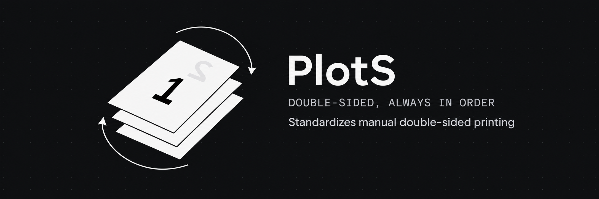
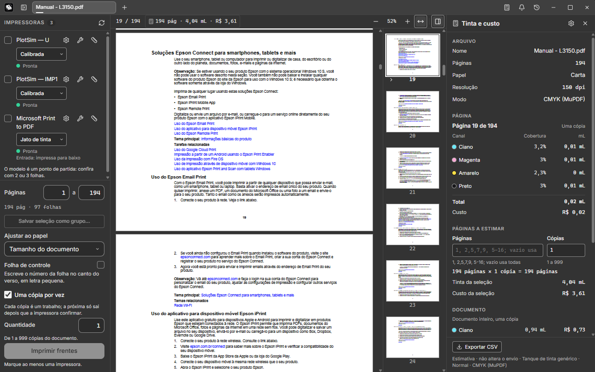
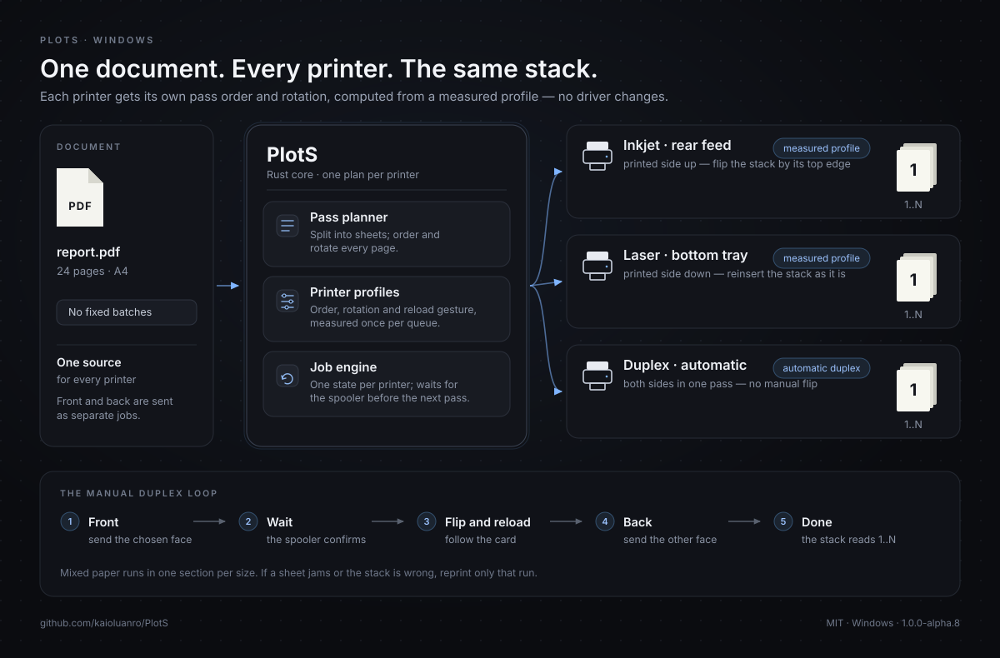

<p align="center">
  
</p>

<h1 align="center">PlotS</h1>

<p align="center"><strong>Double-sided printing, always in order.</strong><br>
A Windows desktop app that makes manual duplex predictable on any printer.</p>

<p align="center">
  <a href="README.pt-BR.md">Português (Brasil)</a> · <strong>English</strong>
</p>

<p align="center">
  
  
  
  
</p>

---

PlotS prints the front of a document, tells you exactly how to pick up and reload the stack, waits for the printer to finish, and then prints the back. Each printer gets its own plan, so the result is the same physical stack whether you use a rear-feed inkjet, a laser with a bottom tray, or both at once.

No driver hacks. No guessing which way the paper goes. No trial-and-error at every run.

> **Alpha software — please read.** The main workflow is implemented in code, but no measurement has been confirmed on a real printer yet. Tests used virtual printers and “Microsoft Print to PDF”, and the installer has been generated but not run on a clean machine. Print a 2–4 page test job before trusting a large one. See [Status and roadmap](#status-and-roadmap).

## Contents

- [Why PlotS exists](#why-plots-exists)
- [What it does](#what-it-does)
- [A look at the app](#a-look-at-the-app)
- [How it works](#how-it-works)
- [Architecture diagram](#architecture-diagram)
- [Install](#install)
- [Quick start](#quick-start)
- [Calibrating a printer](#calibrating-a-printer)
- [Printing options](#printing-options)
- [Multiple printers at once](#multiple-printers-at-once)
- [Ink and cost estimate](#ink-and-cost-estimate-plotinfo)
- [Images](#images)
- [Command-line interface](#command-line-interface)
- [Your data](#your-data)
- [Build from source](#build-from-source)
- [Project structure](#project-structure)
- [Status and roadmap](#status-and-roadmap)
- [FAQ](#faq)
- [License](#license)

## Why PlotS exists

Manual duplex — printing one side, flipping the sheets, then printing the other side — should be simple. In practice, every printer behaves differently:

- A rear-feed inkjet usually delivers pages printed side up, in reverse order.
- A laser with a bottom tray usually delivers them printed side down, in another order.
- Drivers add their own “reverse order”, “skip blank pages”, and paper-path settings — often hidden, sometimes contradictory.
- A wrong flip ruins the whole run, not just one sheet.

PlotS does not try to change the driver. It treats each printer as a **profile**: how paper enters, which side is printed, in what order pages come out, and how the stack must be turned to print the other side. With that profile, one pure algorithm produces the correct send order and rotation for every printer.

## What it does

**Guided manual duplex**
- Prints the chosen face in one run (one job per copy by default), waits for the printer to confirm, then shows a card with a drawing of the reload gesture.
- Sends the other face only after you confirm — the reload step always asks, because a wrong stack wastes paper.
- Handles one-page documents without a blank back sheet or a reload step.
- Reprints a run if a sheet jams or the stack comes out wrong.
- Supports automatic duplex printers too, including mixed paper that has to be handled manually.

**One profile per printer**
- Ready-made inkjet (rear feed) and laser (bottom tray) models as a starting point.
- A two-sheet calibration that measures the printer and asks two simple questions.
- One profile per Windows print queue, with an optional friendly name.
- Compensation for drivers that secretly reverse the job order.

**Several printers at once**
- Mark any number of printers; each one receives the whole document with its own order and rotation.
- Every printer has an independent job card and state machine, so a slow printer does not block the others.
- Save a selection of printers as a group (“Office”, “Front desk”) and apply it in one click.

**Finishing options**
- Front or back, page range, and 1–999 copies. Front and back copies can differ.
- **One copy at a time** (on by default): each copy is a separate job and the next one waits for the printer to confirm the previous one. Useful for drivers that reorder or merge jobs.
- Fit to paper, one section per paper size, and an optional control number on the back.
- Local print history (up to 500 entries) with time and sheet count per printer; it can be disabled or erased.
- Tabs for several documents, drag-and-drop, and keyboard shortcuts.
- Interface in Brazilian Portuguese and English.

**Ink and cost estimate (PlotInfo)**
- A calculator panel estimates ink coverage per channel, volume in mL, cost in the profile’s currency, the first cartridge to run out, the most expensive page, and the document total.
- Exports a CSV with one row per page plus a total row.
- CMYK separation through a separate `mutool` process, with a built-in PDFium fallback.
- This is an estimate based on area and coverage, not a measurement of real consumption. There is no heat map and no ICC profile.

**Images and command line**
- Opens and prints PNG, JPEG, BMP, GIF, WebP, and multi-page TIFF by converting them to a cached PDF.
- A CLI for listing queues, creating profiles, calibrating, generating pass PDFs, simulating, and printing.

## A look at the app

<p align="center">
  
</p>

The main window in one frame: documents in tabs, printers and calibrated models in the left sidebar, the PDF and page range in the center, and the PlotInfo ink estimate on the right. The screenshot shows the Portuguese interface; English is included as well. The simulated PlotSim queues visible in the sidebar are test-only and are not included in the installer.

## How it works

1. **Open.** The PDF is displayed with pdf.js, the PDF engine from Firefox. The viewer only displays; every printing decision lives in the Rust core.
2. **Plan.** `plots-core` splits the document into sheets, pairs the pages, and builds two pass lists per printer. The profile decides whether each pass is sent in normal or reverse order and whether the back pages are rotated 180°.
3. **Rasterize and send.** Most Windows drivers do not accept PDF directly. The Windows backend rasterizes each page with PDFium at the queue’s resolution and sends it through the spooler using GDI.
4. **Wait and guide.** A job thread per printer follows `Idle → Front sent → Waiting for reload → Back sent → Done`, with an error state at any point. The card stays locked until the spooler confirms the front finished.
5. **Print the back.** You pick up the stack, follow the drawing, and confirm. PlotS sends the second pass, already ordered and rotated for that printer.

The profile stores four facts:

| Profile field | What it controls |
| --- | --- |
| First pass reversed | Send the front from the last sheet to the first, for printers that stack output in reverse |
| Second pass reversed | The same choice for the back |
| Rotate back 180° | Compensate for a paper path that turns the sheet around |
| Reload gesture | Flip or do not flip, and which edge enters first — this drives the text and the drawing on the card |

Typical paper paths:

| Printer | Printed side | Reload |
| --- | --- | --- |
| Rear-feed inkjet | Up | Usually flip the stack by its top edge |
| Bottom-tray laser | Down | Usually reinsert the stack as it is |
| Automatic duplex | Both sides in one pass | No manual step |

These are starting points, not assumptions. The calibration measures the actual printer and fills in the profile.

## Architecture diagram

<p align="center">
  
</p>

One source document, one plan per selected printer, independent jobs, the same final stack. The bottom strip is the loop you actually perform: front, wait for the printer, flip and reload, back, done.

## Install

### Option A — Installer (recommended)

1. Open the [Releases](https://github.com/kaioluanro/PlotS/releases) page and download `PlotS_<version>_x64-setup.exe`. The current alpha (`1.0.0-alpha.8`) is distributed as a portable ZIP; if the installer is not listed for your version, use Option B or build it from source.
2. Run it. It is configured to install for the current user only, without asking for administrator rights, in `%LOCALAPPDATA%\PlotS`.
3. If Windows SmartScreen appears, choose **More info → Run anyway**. The installer is not code-signed.
4. If the WebView2 Runtime is missing, the installer downloads it from Microsoft and follows Microsoft’s terms.

The installer is configured to add PlotS to the **Open with** menu for PDF files without changing your default PDF reader. The program you already use should remain the default.

> The installer has been generated, but it has not been executed on a clean machine or account yet. Treat this as an alpha build.

The uninstaller does **not** delete your printer profiles, driver settings, or history. See [Your data](#your-data).

### Option B — Portable

1. Download `PlotS_<version>_x64_portatil.zip` from [Releases](https://github.com/kaioluanro/PlotS/releases).
2. Extract the fixed `PlotS` folder anywhere — a USB drive works too.
3. Run `PlotS.exe`.

When `PLOTS-PORTATIL.txt` sits next to `PlotS.exe`, the profile file also lives in that folder and travels with the program. On first launch it imports what exists in `%APPDATA%\plots\perfis.toml` without deleting the original; after that, the file in the folder is the one that counts. History still lives in `%APPDATA%\plots\historico.toml`.

The portable package includes `pdfium.dll` and a separate `mutool/` folder with the CMYK converter. See [License](#license) for its AGPL terms.

### Requirements

| Requirement | Notes |
| --- | --- |
| Windows 10 or 11, 64-bit | The Windows backend is the only one implemented today |
| WebView2 Runtime | Included in Windows 11 and current Windows 10; the installer can fetch it |
| A printer queue installed in Windows | Physical or virtual |
| Microsoft Visual C++ 2015–2022 (x64) runtime | Only for the CMYK ink estimate through `mutool` in the portable package; without it, PlotS falls back to simple mode and warns |

PDFium is bundled with the app; you do not need to install it separately.

### Updating

Install the new version over the old one. Profiles, driver settings, and history remain in `%APPDATA%\plots`. For the portable version, replace the program files but keep `perfis.toml` if you want to retain the profiles stored beside the executable.

## Quick start

1. **Open PlotS.** The welcome screen appears, then the main window.
2. **Open a document.** Press `Ctrl+O`, drag a PDF onto the window, use **Open with**, or click the `+` button. Each document gets its own tab.
3. **Pick the printer.** Select one or more printers in the sidebar. If a printer has no profile yet, calibrate it or choose the inkjet/laser model as a starting point.
4. **Choose the face and copies.** At the bottom, select **Front**, set the page range and the number of copies. The default **One copy at a time** is the safest choice for most printers.
5. **Print the front.** Confirm the summary. The card appears and follows the job.
6. **Reload the stack.** When the front finishes, read the card and follow the drawing. Put the stack back exactly as instructed.
7. **Print the back.** Choose **Back** (or click the button on the card), confirm, and wait. The stack should now read 1 to N.
8. **If something goes wrong**, use **Reprint** on the card to redo only that run.

For a first test, use 2–4 pages and ordinary paper. Check the orientation and the page order before printing a long document.

## Calibrating a printer

Calibration is a one-time, two-sheet measurement per printer. It is the difference between “probably right” and “right on this printer”.

1. In the sidebar, open the calibration action for the printer.
2. PlotS sends two test sheets containing pages 1–4 with large numbers and orientation arrows.
3. Pick up the sheets as they came out and reload them the way you normally would.
4. Answer two questions: is page 2 on the back of page 1, and is page 2 upside down?
5. Review the answers. You can correct the last answer without printing again.
6. Save. The profile is written to `perfis.toml`.

Tips:

- Set the driver first: correct paper, quality, and no “reverse order” or “skip blank pages” option.
- The inkjet and laser presets are a starting point, not a measurement.
- Recalibrate after changing the driver, the paper path, or the way you reload the stack.
- The calibration result only proves itself in a real printed run. Simulation is not a substitute for paper.

## Printing options

| Option | What it does |
| --- | --- |
| **Front / Back** | Prints only the chosen face. The choice never changes by itself; only you change it. |
| **Quantity** | 1–999 copies. Front and back can have different values; the confirmation warns when the stack and the count do not match. |
| **One copy at a time** | On by default. Each copy is a separate job; the next one is sent only after the printer confirms the previous one. Turn it off to send all copies as one continuous job. |
| **Page range** | Prints only the selected pages. The preview shows the selected pages. |
| **Fit to paper** | Off by default. Scales the document proportionally and centers it on the chosen paper, without cropping. The confirmation shows the scale. |
| **Control sheet** | Off by default. Adds a small number on the back so you can check whether the stack was reloaded correctly. |
| **Driver reverses order** | Per-printer option. Compensates when the driver sends jobs in reverse. PlotS cannot detect this reliably on every driver, so there is also a warning before manual printing. |

**Mixed paper.** When the document has pages of different sizes, PlotS creates one section per paper size and prints the pair separately, with a blank back for the odd sheet. The preview and the confirmation say what will happen before paper is spent.

**A stack larger than the input tray.** The confirmation warns above 30 sheets. On the front, refill with blank paper when the printer asks. On the back, keep the top of the stack in order and add the rest when the input empties.

**Printing from another program.** PlotS does not yet install a virtual printer queue. Export or save the document as PDF, then open it in PlotS or use **Open with → PlotS**. A virtual “PlotS” queue that opens the app from any program is planned after the first release.

## Multiple printers at once

Mark several printers in the sidebar and click print. Every selected printer receives the **whole document**, each with its own profile, order, and rotation. This is useful for making several copies on different machines or for keeping a slow printer working alongside a fast one.

- Each printer has its own card, state machine, and spooler polling. A printer that is busy, out of paper, or jammed does not stop the others.
- The final stack is correct on each printer, independent of the paper path.
- Saved groups store a selection of printers under a name, so you do not have to mark them one by one.
- Print history records time and sheet count per printer. If one printer is more than 25% faster, the confirmation tells you, but the work is not redistributed automatically.
- Splitting the document among printers by speed is planned for after the first release. Today all marked printers print the same content.

## Ink and cost estimate (PlotInfo)

The calculator icon next to the bell opens a drawer with an **estimate** of ink and cost for the open document:

- Per-channel coverage, volume in mL, cost in the profile’s currency.
- The cartridge that runs out first, the document total, and the most expensive page.
- Its own page selection and copy count, independent of the print range, face, and copies. Changing the panel does not change what is sent to the printer.
- CSV export with one row per page and one total row.
- Editable ink profiles: volume, yield, and price per mL, saved in `plotinfo.toml` beside the printer profiles.

Two analysis modes:

- **CMYK** — the separate `mutool` process separates the pages and reads coverage from the PAM output. Available in the portable package.
- **Simple** — PDFium rasterizes the pages and a per-color formula calculates CMYK. Works without `mutool`; the drawer shows a translated warning when the converter is missing or fails.

The numbers come from area and coverage. They are not a measurement of real printer consumption, and they do not include a heat map or an ICC profile. Use them to compare pages, not to predict a cartridge’s exact life.

## Images

PlotS opens and prints PNG, JPEG, BMP, GIF, WebP, and multi-page TIFF. Each image becomes a **derived PDF** in a local cache; the original file is never modified. Preview, page count, front/back, and printing all use the same PDF path.

- A4 page by default, with the image fitted proportionally and white margins.
- “Physical size from DPI” is available for PNG, JPEG, BMP, and TIFF. GIF and WebP without DPI fall back to A4.
- Transparency is composited over white.
- Each TIFF frame becomes a page.
- Limits: 1 GiB per file and 100 megapixels per frame, with a clear refusal above that.
- The cache lives in `%LOCALAPPDATA%\plots\cache\imagens` and is cleaned after 30 days.

## Command-line interface

The CLI is a developer tool built from this repository; it is not part of the installed app. The help text calls the command `plots`. A local build produces `plots-cli.exe`, so use `cargo run -p plots-cli --` or rename the binary.

| Command | What it does |
| --- | --- |
| `plots filas` | Lists Windows queues with state, driver, port, default flag, and whether a profile exists. Read-only. |
| `plots perfil NOME --modelo jato\|laser` | Saves a ready-made profile for a queue. The queue does not need to exist. |
| `plots gerar-calibracao --saida DIR` | Writes `calibracao.pdf` with pages 1–4 and arrows. Never overwrites an existing file. |
| `plots calibrar NOME --saida DIR` | Writes the calibration PDF, asks the questions in the terminal, and saves the adjusted profile. Does not print. |
| `plots gerar-pdf ARQUIVO --lote K --impressora traseira\|gaveta --saida DIR` | Writes the pass PDFs for each batch. |
| `plots simular --paginas N --lote K --impressora traseira\|gaveta` | Simulates the flow and checks the final stack without printing. |
| `plots imprimir ARQUIVO --impressora NOME --lote K` | Sends to a real queue, batch by batch, with a confirmation before each send. |
| `plots imprimir ARQUIVO --impressora NOME --lote K --simular --saida DIR` | Walks the same flow but only writes the pass PDFs. |

Only `imprimir` without `--simular` sends anything to a printer. `traseira` and `gaveta` are shortcuts for the inkjet and laser models in the CLI; a saved profile can use any queue name.

```powershell
# List the queues Windows knows about
cargo run -p plots-cli -- filas

# Save a starting profile for a queue
cargo run -p plots-cli -- perfil "Sala" --modelo laser

# Generate and walk through a real print, 10 sheets per batch
cargo run -p plots-cli -- imprimir report.pdf --impressora "Sala" --lote 10

# Try the whole flow without spending paper
cargo run -p plots-cli -- simular --paginas 24 --lote 10 --impressora traseira --guiado
```

## Your data

PlotS keeps everything local. It does not send profiles, history, or documents over the internet.

### Profiles and driver settings

In the installed app, printer profiles and driver settings — the ones saved with the gear icon or in the printer options — live in `%APPDATA%\plots\perfis.toml`, a plain text file. Driver settings are stored as Base64, which is **not encryption**, and PlotS does not interpret what each manufacturer’s driver puts there. If your driver uses a password, PIN, or user code, that data may be in this file; do not share it.

To remove a printer’s saved settings, use **Use default** on its row (also available in the options panel). To remove everything in the installed app, close PlotS and delete the `plots` folder. In the portable version, also delete the `perfis.toml` beside `PlotS.exe` **and** the copy in `%APPDATA%\plots` (or the whole folder) — deleting only one is not enough, because the local file remains or the `%APPDATA%` copy comes back on the next launch.

On the next launch, the installed app starts with no profiles, no driver settings, and no history, and **Save history** is enabled again. Turn it off again if you do not want new entries.

### History

Print history lives in `%APPDATA%\plots\historico.toml`, also as plain text, and keeps up to 500 jobs sent from the window: the printed file name (without the folder), date, printers, face, pages, range, batches, result, and the time, sheet count, and route (manual or automatic) of each printer.

A file name or printer name can reveal personal or work information, and anyone using the same Windows account can read the list. PlotS does not send history over the internet. To stop recording new jobs, turn off **Save history** in the history dialog. To erase it, open the history from the title bar and choose **Erase history**. A job that started with the option on enters the list when it finishes, even if you turn the option off or erase the list before that.

### Windows print log

When a job leaves the queue, PlotS checks the Windows print log, when it can read it, for a failure on that queue. The event content is used only for that comparison: it is not stored, displayed, or sent. If the log cannot be read, the job continues as completed.

### Roaming profiles

`%APPDATA%` is the Roaming folder. On a computer with a roaming profile (for example, a company or school machine), Windows may copy this folder to a server and bring it to other computers, including printer names, driver settings stored in the file, and the history with printed file names.

### Uninstall

The uninstaller was configured to keep profiles, driver settings, and history.

## Build from source

### Prerequisites

- Windows 10 or 11, 64-bit.
- [Rust](https://rustup.rs/) stable with the MSVC toolchain, plus the **Desktop development with C++** workload from Visual Studio Build Tools.
- [Node.js](https://nodejs.org/) 20.19+ or 22.12+ (22 LTS recommended).
- WebView2 Runtime.
- Git.

### Run the app

```powershell
git clone https://github.com/kaioluanro/PlotS.git
cd PlotS

# Fetch the pinned PDFium build into %LOCALAPPDATA%\plots-build\pdfium
node scripts/baixar-pdfium.mjs

# Install and build the interface
npm --prefix ui ci
npm --prefix ui run build

# Run the desktop app
cargo run -p plots-app
```

The app reads the interface from `ui/dist`, so build the UI before running the Rust binary. After changing the interface, rebuild `ui/dist` and run the app again.

### Tests

```powershell
cargo test --workspace
npm --prefix ui test
```

The project’s CI gate is `cargo test --workspace`, and the success line is `CI_SUCCESS: cargo test --workspace`. The UI suite uses Vitest.

### Build the installer

```powershell
node scripts/baixar-pdfium.mjs
$env:PLOTS_PDFIUM_DIR = "$env:LOCALAPPDATA\plots-build\pdfium\chromium-8125"
node scripts/empacotar.mjs
```

The installer is written to `%LOCALAPPDATA%\plots-build\instalador\saidas`. The script also checks that `THIRD-PARTY-NOTICES` is current; regenerate it after dependency changes with:

```powershell
node scripts/gerar-avisos.mjs
```

The installer build disables the simulated printers (`--no-default-features`), so test-only queues do not ship to users.

## Project structure

| Path | Responsibility |
| --- | --- |
| `plots-core/` | Pure planning: batches, pass order, rotation, blank page, calibration math. No I/O. |
| `plots-print/` | Job state machine, flow, simulation backend, stack checking. |
| `plots-pdf/` | PDF generation, calibration sheets, image-to-PDF conversion. |
| `plots-perfis/` | Profiles, saved groups, history, storage format. |
| `plots-windows/` | Windows backend: queue discovery, spooler, GDI drawing, driver settings. |
| `plots-info/` | Ink coverage and cost engine (PlotInfo). |
| `plots-cli/` | Command-line interface. |
| `src-tauri/` | Tauri 2 application backend and commands. |
| `ui/` | React + TypeScript interface, pdf.js viewer, CSS modules. |
| `PlotSim/` | Virtual-printer test suite, not included in the installer. |
| `scripts/` | PDFium download, packaging, notices, versioning, installer hooks. |
| `plan/` | Functional specifications and status for each feature. |
| `imgs/` | Banner, screenshot, and architecture diagram used by the READMEs. |

## Status and roadmap

**Current version: `1.0.0-alpha.8`.**

Implemented and verified in code (not yet on paper):

- Manual duplex with per-printer profiles, calibration, and guided reload.
- Inkjet, laser, and automatic duplex modes.
- Multiple printers at once, independent jobs, saved groups.
- Page range, copies, one copy at a time, mixed paper, fit to paper, control sheet.
- Driver order compensation, local history, and print time.
- PlotInfo ink and cost estimate, CSV export, CMYK via `mutool`.
- Images, tabs, drag-and-drop, keyboard shortcuts, Portuguese and English UI.
- CLI, installer, portable package, third-party notices.

Not yet verified on real hardware:

- Actual paper position and stack order on physical printers.
- The installer on a clean machine or account (shortcuts, Open with, uninstall, WebView2 download).
- The real driver options window with OK and Cancel.
- Automatic duplex on a real two-sided printer.

Planned after the first release:

- A virtual **PlotS** print queue that opens the app when you print from any program.
- Linux and macOS backends.
- Splitting work across printers by measured speed.

Known limits:

- Windows only.
- The ink panel is an estimate, not a measurement.
- A driver can still ignore the requested settings, and a jam affects the whole run.
- The alpha builds have no code signature, so SmartScreen may warn.

## FAQ

**Do I need to calibrate every printer?**
Yes, once per printer queue. The inkjet/laser presets can get you started, but only calibration measures the actual paper path and the way you reload the stack.

**Does PlotS replace my PDF reader?**
No. The installer adds PlotS to the **Open with** menu for PDFs but does not change the default reader. You can also drag a PDF onto the window or press `Ctrl+O`.

**Can I print from Word, Firefox, or another app?**
Export to PDF first, then open it in PlotS. The virtual “PlotS” queue that would accept jobs from any program is planned for later.

**Does it work with automatic duplex printers?**
Yes. Choose the automatic mode for that printer; PlotS sends both sides in one pass. If the document has paper the printer cannot duplex, PlotS handles that section manually with the same guided flow.

**Why does PlotS rasterize the pages?**
Most Windows drivers do not accept PDF directly. Rasterizing with PDFium at the queue’s resolution is the reliable path across drivers. The original PDF is never modified.

**What happens if the printer jams or the stack is wrong?**
Use **Reprint** on the card to redo only that run. Small test jobs and the control sheet make mistakes easier to catch.

**Does PlotS need the internet?**
No. Everything runs locally. The installer may download WebView2 from Microsoft if it is missing.

**Can I use it on Linux or macOS?**
Not yet. The architecture has a backend trait ready for CUPS/IPP, but only the Windows backend is implemented.

**Where are my profiles and history?**
In `%APPDATA%\plots` (`perfis.toml`, `historico.toml`, `plotinfo.toml`), or beside the executable in the portable version for the profiles. See [Your data](#your-data).

## License

PlotS is free software under the **MIT License** — see [`LICENSE`](LICENSE). Third-party components keep their own licenses, collected in [`THIRD-PARTY-NOTICES`](THIRD-PARTY-NOTICES), which also ships with the installed program.

The portable package includes a separate `mutool.exe` from MuPDF 1.28.5 under the **GNU Affero General Public License 3.0 or later**. It is not linked to PlotS: it runs as a separate process to separate pages into CMYK. PlotS itself remains MIT. The binary occupies about 44 MB and the portable package grows by roughly the same amount. The full AGPL text, the `thirdparty/` licenses, and the corresponding-source address are in `mutool/` (`AGPL-3.0.txt` and `MUPDF-SOURCE.txt`).

MuPDF and Artifex are trademarks of Artifex Software, Inc.; PlotS is not affiliated with, sponsored by, or endorsed by Artifex.

The official `mutool.exe` requires the Microsoft Visual C++ 2015–2022 (x64) runtime. Without it, the converter does not start and PlotS falls back to simple mode with a warning; the simple mode does not depend on it.

---

<p align="center">
  <sub>PlotS is developed by <a href="https://github.com/kaioluanro">Kaio Luan</a>.
  If this saves you paper, consider starring the repository.</sub>
</p>
