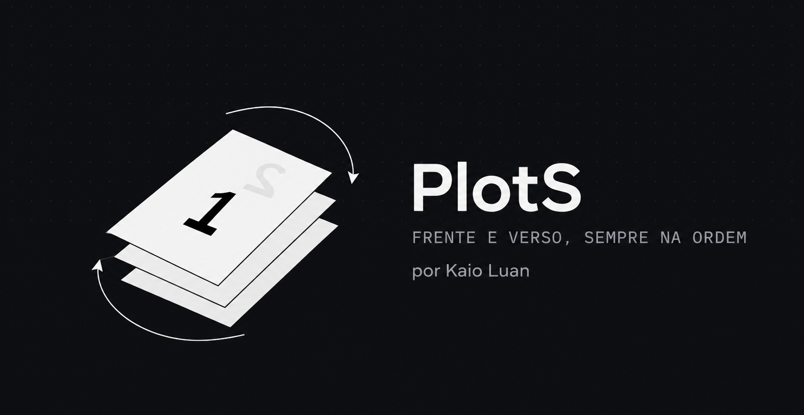
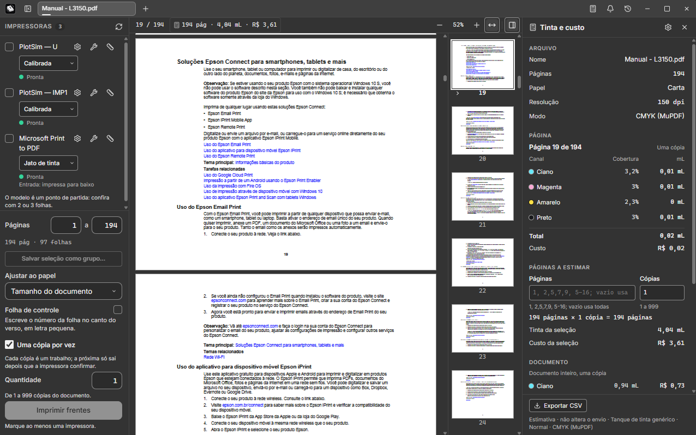
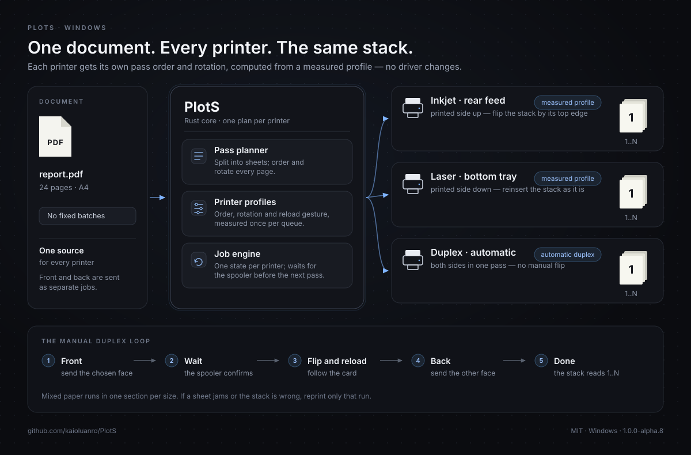

<p align="center">
  
</p>

<h1 align="center">PlotS</h1>

<p align="center"><strong>Frente e verso, sempre na ordem.</strong><br>
Um aplicativo para Windows que torna a impressão frente e verso manual previsível em qualquer impressora.</p>

<p align="center">
  <strong>Português (Brasil)</strong> · <a href="README.md">English</a>
</p>

<p align="center">
  
  
  
  
</p>

---

O PlotS imprime a frente de um documento, diz exatamente como pegar e recolocar o maço, espera a impressora terminar e só então imprime o verso. Cada impressora recebe o próprio plano, então o resultado físico é o mesmo seja numa impressora jato de tinta de entrada traseira, numa laser de gaveta ou nas duas ao mesmo tempo.

Sem mexer no driver. Sem adivinhar o lado do papel. Sem tentativa e erro a cada envio.

> **Versão alfa — leia antes de usar.** O fluxo principal está implementado no código, mas nenhuma medida foi conferida em impressora real. Os testes usaram impressoras virtuais e a fila “Microsoft Print to PDF”, e o instalador foi gerado mas ainda não foi executado numa máquina limpa. Imprima de 2 a 4 páginas de teste antes de confiar um documento grande. Veja [Estado e próximos passos](#estado-e-próximos-passos).

## Índice

- [Por que o PlotS existe](#por-que-o-plots-existe)
- [O que ele faz](#o-que-ele-faz)
- [Uma olhada no programa](#uma-olhada-no-programa)
- [Como funciona](#como-funciona)
- [Diagrama da arquitetura](#diagrama-da-arquitetura)
- [Instalar](#instalar)
- [Primeiros passos](#primeiros-passos)
- [Calibrar uma impressora](#calibrar-uma-impressora)
- [Opções de impressão](#opções-de-impressão)
- [Várias impressoras ao mesmo tempo](#várias-impressoras-ao-mesmo-tempo)
- [Estimativa de tinta e custo](#estimativa-de-tinta-e-custo-plotinfo)
- [Imagens](#imagens)
- [Linha de comando](#linha-de-comando)
- [Seus dados](#seus-dados)
- [Compilar a partir do código](#compilar-a-partir-do-código)
- [Estrutura do projeto](#estrutura-do-projeto)
- [Estado e próximos passos](#estado-e-próximos-passos)
- [Perguntas frequentes](#perguntas-frequentes)
- [Licença](#licença)

## Por que o PlotS existe

Imprimir frente e verso manualmente — imprimir um lado, virar as folhas e imprimir o outro — deveria ser simples. Na prática, cada impressora se comporta de um jeito:

- A jato de tinta de entrada traseira costuma entregar as folhas com a face impressa para cima, na ordem inversa.
- A laser de gaveta costuma entregá-las com a face impressa para baixo, em outra ordem.
- Os drivers acrescentam “ordem inversa”, “pular páginas em branco” e opções de caminho do papel — muitas vezes escondidas, às vezes contraditórias.
- Uma virada errada estraga o maço inteiro, não só uma folha.

O PlotS não tenta corrigir o driver. Ele trata cada impressora como um **perfil**: por onde o papel entra, qual lado é impresso, em que ordem as páginas saem e como o maço precisa ser virado para receber o outro lado. Com esse perfil, um único algoritmo puro calcula a ordem de envio e a rotação certas para qualquer impressora.

## O que ele faz

**Frente e verso guiados**
- Imprime a face escolhida numa sequência (um trabalho por cópia por padrão), espera a impressora confirmar e mostra um cartão com o desenho do gesto de recolocação.
- Só envia a outra face depois da sua confirmação — o verso sempre pergunta, porque um maço errado gasta papel.
- Documento de uma página sai sem folha em branco no verso e sem pedir recolocação.
- Reimprime um trecho quando uma folha atola ou o maço sai errado.
- Também imprime nas impressoras com frente e verso automático, inclusive nos papéis que precisam ser tratados à mão.

**Um perfil por impressora**
- Modelos prontos de jato de tinta (entrada traseira) e laser (gaveta) como ponto de partida.
- Calibração de duas folhas que mede a impressora e faz duas perguntas simples.
- Um perfil por fila do Windows, com apelido amigável opcional.
- Compensação para drivers que invertem a ordem do trabalho sem avisar.

**Várias impressoras ao mesmo tempo**
- Marque quantas quiser; cada uma recebe o documento inteiro com a própria ordem e rotação.
- Cada impressora tem cartão e máquina de estados independentes, então uma lenta não trava as outras.
- Salve uma seleção de impressoras como grupo (“Escritório”, “Recepção”) e aplique com um clique.

**Acabamento**
- Frente ou verso, intervalo de páginas e de 1 a 999 cópias. As cópias da frente e do verso podem ser diferentes.
- **Uma cópia por vez** (ligada por padrão): cada cópia é um trabalho separado e a próxima só sai depois que a impressora confirma a anterior. Útil para drivers que reordenam ou juntam trabalhos.
- Ajustar ao papel, uma seção por tamanho de papel e número de controle opcional no verso.
- Histórico local de impressão (até 500 envios) com tempo e folhas por impressora; pode ser desligado ou apagado.
- Abas para vários documentos, arrastar e soltar e atalhos de teclado.
- Interface em português do Brasil e inglês.

**Estimativa de tinta e custo (PlotInfo)**
- Um painel calcula a cobertura por canal, o volume em mL, o custo na moeda do perfil, o cartucho que acaba primeiro, a página mais cara e o total do documento.
- Exporta um CSV com uma linha por página e uma de total.
- Separação CMYK por um processo `mutool` separado e modo simples pelo PDFium.
- É uma **estimativa** por área e cobertura, não uma medição do consumo real. Não há mapa de calor nem perfil ICC.

**Imagens e linha de comando**
- Abre e imprime PNG, JPEG, BMP, GIF, WebP e TIFF multipágina, convertendo cada imagem num PDF derivado em cache.
- Um CLI para listar filas, criar perfis, calibrar, gerar os PDFs das passadas, simular e imprimir.

## Uma olhada no programa

<p align="center">
  
</p>

A janela principal numa só imagem: documentos em abas, impressoras e modelos calibrados na lateral esquerda, o PDF e o intervalo de páginas no centro, e a estimativa de tinta do PlotInfo à direita. A captura mostra a interface em português; o inglês também está incluído. As filas simuladas do PlotSim que aparecem na lateral são só de teste e não entram no instalador.

## Como funciona

1. **Abrir.** O PDF é exibido com o pdf.js, o leitor de PDF do Firefox. A visualização só mostra; toda decisão de impressão fica no núcleo em Rust.
2. **Planejar.** O `plots-core` divide o documento em folhas, forma os pares de páginas e monta duas listas de passada por impressora. O perfil decide se cada passada vai na ordem normal ou inversa e se as páginas do verso giram 180°.
3. **Rasterizar e enviar.** A maioria dos drivers do Windows não aceita PDF direto. O backend do Windows rasteriza cada página com o PDFium na resolução da fila e envia pelo spooler usando GDI.
4. **Esperar e guiar.** Uma thread de trabalho por impressora segue `Ocioso → Frente enviada → Aguardando recolocação → Verso enviado → Concluído`, com estado de erro em qualquer ponto. O cartão fica travado até o spooler confirmar que a frente terminou.
5. **Imprimir o verso.** Você pega o maço, segue o desenho e confirma. O PlotS envia a segunda passada já ordenada e girada para aquela impressora.

O perfil guarda quatro informações:

| Campo do perfil | O que controla |
| --- | --- |
| Primeira passada inversa | Enviar a frente da última folha para a primeira, para impressoras que empilham a saída ao contrário |
| Segunda passada inversa | A mesma escolha para o verso |
| Girar o verso 180° | Compensar um caminho de papel que vira a folha |
| Gesto de recolocação | Virar ou não virar, e qual borda entra primeiro — é o que gera o texto e o desenho do cartão |

Caminhos de papel típicos:

| Impressora | Face impressa | Recolocação |
| --- | --- | --- |
| Jato de tinta, entrada traseira | Para cima | Costuma virar o maço pela borda de cima |
| Laser, gaveta inferior | Para baixo | Costuma voltar como saiu, sem virar |
| Frente e verso automático | As duas faces de uma vez | Sem gesto manual |

Isso é ponto de partida, não presunção. A calibração mede a impressora de verdade e preenche o perfil.

## Diagrama da arquitetura

<p align="center">
  
</p>

Um documento de origem, um plano por impressora marcada, trabalhos independentes, o mesmo maço final. A faixa de baixo é o ciclo que você executa: frente, espera pela impressora, vira e recoloca, verso, pronto.

## Instalar

### Opção A — Instalador (recomendado)

1. Abra a página de [versões](https://github.com/kaioluanro/PlotS/releases) e baixe `PlotS_<versão>_x64-setup.exe`. A versão alfa atual (`1.0.0-alpha.8`) sai como ZIP portátil; se o instalador não estiver listado para a sua versão, use a Opção B ou gere-o a partir do código.
2. Execute. Ele foi configurado para instalar só para o usuário atual, sem pedir administrador, em `%LOCALAPPDATA%\PlotS`.
3. Se o SmartScreen do Windows aparecer, escolha **Mais informações → Executar assim mesmo**. O instalador não é assinado.
4. Se o WebView2 Runtime faltar, o instalador o baixa da Microsoft e segue os termos dela.

O instalador está configurado para registrar o PlotS no menu **Abrir com** dos arquivos PDF sem mudar o leitor padrão. O programa que você já usa deve continuar sendo o padrão.

> O instalador foi gerado, mas ainda não foi executado numa máquina ou conta limpa. Trate esta versão como alfa.

O desinstalador **não** apaga os perfis das impressoras, os ajustes do driver nem o histórico. Veja [Seus dados](#seus-dados).

### Opção B — Portátil

1. Baixe `PlotS_<versão>_x64_portatil.zip` na página de [versões](https://github.com/kaioluanro/PlotS/releases).
2. Extraia a pasta fixa `PlotS` em qualquer lugar — um pendrive também serve.
3. Execute `PlotS.exe`.

Com um arquivo `PLOTS-PORTATIL.txt` ao lado do `PlotS.exe`, o arquivo de perfis também fica nessa pasta e viaja com o programa. Na primeira abertura, ele traz o que existir em `%APPDATA%\plots\perfis.toml` sem apagar o original; depois disso, o arquivo da pasta é o que vale. O histórico continua em `%APPDATA%\plots\historico.toml`.

O pacote portátil inclui a `pdfium.dll` e uma pasta `mutool/` separada com o conversor CMYK. Veja a [licença](#licença) para os termos da AGPL.

### Requisitos

| Requisito | Observação |
| --- | --- |
| Windows 10 ou 11, 64 bits | O backend do Windows é o único implementado hoje |
| WebView2 Runtime | Vem no Windows 11 e no Windows 10 atualizado; o instalador consegue baixá-lo |
| Uma fila de impressão instalada no Windows | Física ou virtual |
| Runtime Microsoft Visual C++ 2015–2022 (x64) | Só para a estimativa CMYK pelo `mutool` no pacote portátil; sem ele, o PlotS cai no modo simples com aviso |

O PDFium acompanha o programa; não é preciso instalá-lo à parte.

### Atualizar

Instale a versão nova por cima da antiga. Perfis, ajustes do driver e histórico continuam em `%APPDATA%\plots`. Na versão portátil, substitua os arquivos do programa mas mantenha o `perfis.toml` se quiser conservar os perfis guardados ao lado do executável.

## Primeiros passos

1. **Abra o PlotS.** A tela de abertura aparece e depois a janela principal.
2. **Abra um documento.** Use `Ctrl+O`, arraste um PDF para a janela, use **Abrir com** ou clique no botão `+`. Cada documento ganha uma aba própria.
3. **Escolha a impressora.** Marque uma ou mais na lateral. Se a impressora ainda não tiver perfil, calibre ou escolha o modelo jato de tinta/laser como ponto de partida.
4. **Escolha a face e as cópias.** No rodapé, selecione **Frente**, ajuste o intervalo e o número de cópias. O padrão **Uma cópia por vez** é a escolha mais segura para a maioria das impressoras.
5. **Imprima a frente.** Confira o resumo. O cartão aparece e acompanha o trabalho.
6. **Recoloque o maço.** Quando a frente terminar, leia o cartão e siga o desenho. Coloque o maço de volta exatamente como indicado.
7. **Imprima o verso.** Escolha **Verso** (ou clique no botão do cartão), confirme e espere. O maço agora deve ler de 1 a N.
8. **Se algo der errado**, use **Reimprimir** no cartão para refazer só aquele trecho.

No primeiro teste, use de 2 a 4 páginas em papel comum. Confira a orientação e a ordem das páginas antes de imprimir um documento longo.

## Calibrar uma impressora

A calibração é uma medida única, de duas folhas, por impressora. É a diferença entre “provavelmente certo” e “certo nesta impressora”.

1. Na lateral, abra a ação de calibração da impressora.
2. O PlotS envia duas folhas de teste com as páginas 1 a 4, números grandes e setas de orientação.
3. Pegue as folhas como saíram e recoloque-as do jeito que você costuma fazer.
4. Responda duas perguntas: a página 2 está no verso da página 1? A página 2 está de cabeça para baixo?
5. Confira as respostas. Dá para corrigir a última resposta sem imprimir de novo.
6. Salve. O perfil é gravado no `perfis.toml`.

Dicas:

- Ajuste o driver primeiro: papel correto, qualidade e nenhuma opção de “ordem inversa” ou “pular páginas em branco”.
- Os modelos jato de tinta e laser são ponto de partida, não medição.
- Calibre de novo depois de trocar o driver, o caminho do papel ou o jeito de recolocar o maço.
- O resultado da calibração só se comprova numa impressão de verdade. A simulação não substitui o papel.

## Opções de impressão

| Opção | O que faz |
| --- | --- |
| **Frente / Verso** | Imprime só a face escolhida. A escolha nunca muda sozinha; só você a troca. |
| **Quantidade** | De 1 a 999 cópias. Frente e verso podem ter valores diferentes; a confirmação avisa quando o maço e a contagem não batem. |
| **Uma cópia por vez** | Ligada por padrão. Cada cópia é um trabalho separado; a próxima só é enviada depois que a impressora confirma a anterior. Desmarcada, todas as cópias saem num trabalho contínuo. |
| **Intervalo de páginas** | Imprime só as páginas escolhidas. A prévia mostra as páginas selecionadas. |
| **Ajustar ao papel** | Desligada por padrão. Imprime o documento no papel escolhido, em escala proporcional e centralizado, sem cortar. A confirmação mostra a escala. |
| **Folha de controle** | Desligada por padrão. Acrescenta um número discreto no verso para conferir se o maço entrou certo. |
| **O driver inverte a ordem** | Opção por impressora. Compensa quando o driver envia os trabalhos ao contrário. O PlotS não consegue detectar isso em todo driver, por isso também há um aviso antes do envio manual. |

**Papéis mistos.** Quando o documento tem páginas de tamanhos diferentes, o PlotS cria uma seção por tamanho de papel e imprime o par separadamente, com verso em branco para a folha ímpar. A prévia e a confirmação dizem o que vai acontecer antes de gastar papel.

**Maço maior que a bandeja.** A confirmação avisa acima de 30 folhas. Na frente, complete com papel em branco quando a impressora pedir. No verso, mantenha o topo do maço na ordem e acrescente o resto quando a entrada esvaziar.

**Imprimir de outro programa.** O PlotS ainda não instala uma fila de impressora virtual. Exporte ou salve o documento em PDF e abra no PlotS, ou use **Abrir com → PlotS**. Uma fila virtual “PlotS”, que abre o aplicativo a partir de qualquer programa, está planejada para depois da primeira versão.

## Várias impressoras ao mesmo tempo

Marque várias impressoras na lateral e clique em imprimir. Cada impressora marcada recebe o **documento inteiro**, com o próprio perfil, a própria ordem e a própria rotação. Isso serve para fazer várias cópias em máquinas diferentes ou para manter uma impressora lenta trabalhando ao lado de uma rápida.

- Cada impressora tem cartão, máquina de estados e consulta ao spooler próprios. Uma impressora ocupada, sem papel ou atolada não para as outras.
- O maço final sai certo em cada impressora, independentemente do caminho do papel.
- Grupos salvos guardam uma seleção de impressoras com um nome, para não marcar uma por uma.
- O histórico registra tempo e folhas por impressora. Se uma for mais de 25% mais rápida, a confirmação avisa, mas o trabalho não é redistribuído automaticamente.
- A divisão do documento entre impressoras por velocidade está planejada para depois da primeira versão. Hoje todas as marcadas imprimem o mesmo conteúdo.

## Estimativa de tinta e custo (PlotInfo)

O ícone de calculadora ao lado do sino abre uma gaveta com uma **estimativa** de tinta e custo do documento aberto:

- Cobertura por canal, volume em mL e custo na moeda do perfil.
- O cartucho que acaba primeiro, o total do documento e a página mais cara.
- Seleção de páginas e cópias próprias do painel, independentes do intervalo, da face e das cópias do envio. Mudar o painel não altera o que vai para a impressora.
- Exportação CSV com uma linha por página e uma de total.
- Perfis de tinta editáveis: volume, rendimento e preço por mL, salvos em `plotinfo.toml` ao lado dos perfis das impressoras.

Dois modos de análise:

- **CMYK** — o processo `mutool` separado separa as páginas e lê a cobertura do PAM. Disponível no pacote portátil.
- **Simples** — o PDFium rasteriza as páginas e uma fórmula por cor calcula o CMYK. Funciona sem o `mutool`; a gaveta mostra um aviso traduzido quando o conversor falta ou falha.

Os números vêm da área e da cobertura. Não são uma medição do consumo real e não incluem mapa de calor nem perfil ICC. Use para comparar páginas, não para prever a vida exata de um cartucho.

## Imagens

O PlotS abre e imprime PNG, JPEG, BMP, GIF, WebP e TIFF multipágina. Cada imagem vira um **PDF derivado** num cache local; o arquivo original nunca é alterado. Prévia, contagem de páginas, frente/verso e impressão usam o mesmo caminho do PDF.

- Página A4 por padrão, com a imagem ajustada proporcionalmente e margens brancas.
- “Tamanho físico pelo DPI” para PNG, JPEG, BMP e TIFF. GIF e WebP sem DPI caem em A4.
- Transparência composta sobre branco.
- Cada quadro de um TIFF vira uma página.
- Limites: 1 GiB por arquivo e 100 megapixels por quadro, com recusa clara acima disso.
- O cache fica em `%LOCALAPPDATA%\plots\cache\imagens` e é limpo depois de 30 dias.

## Linha de comando

O CLI é uma ferramenta de desenvolvimento deste repositório; ele não faz parte do programa instalado. O texto de ajuda chama o comando de `plots`. A compilação local gera `plots-cli.exe`, então use `cargo run -p plots-cli --` ou renomeie o binário.

| Comando | O que faz |
| --- | --- |
| `plots filas` | Lista as filas do Windows com estado, driver, porta, se é a padrão e se tem perfil. Só leitura. |
| `plots perfil NOME --modelo jato\|laser` | Grava um perfil pronto para uma fila. A fila não precisa existir. |
| `plots gerar-calibracao --saida DIR` | Grava `calibracao.pdf` com as páginas 1 a 4 e setas. Nunca sobrescreve um arquivo existente. |
| `plots calibrar NOME --saida DIR` | Grava o PDF de calibração, faz as perguntas no terminal e salva o perfil ajustado. Não imprime. |
| `plots gerar-pdf ARQUIVO --lote K --impressora traseira\|gaveta --saida DIR` | Grava os PDFs das passadas de cada lote. |
| `plots simular --paginas N --lote K --impressora traseira\|gaveta` | Simula o fluxo e confere o maço final sem imprimir. |
| `plots imprimir ARQUIVO --impressora NOME --lote K` | Envia para uma fila real, lote a lote, com confirmação antes de cada envio. |
| `plots imprimir ARQUIVO --impressora NOME --lote K --simular --saida DIR` | Percorre o mesmo fluxo, mas só grava os PDFs das passadas. |

Só `imprimir` sem `--simular` envia algo para a impressora. `traseira` e `gaveta` são atalhos para os modelos jato de tinta e laser no CLI; um perfil salvo pode usar qualquer nome de fila.

```powershell
# Lista as filas que o Windows conhece
cargo run -p plots-cli -- filas

# Grava um perfil de partida para uma fila
cargo run -p plots-cli -- perfil "Sala" --modelo laser

# Gera e conduz uma impressão real, 10 folhas por lote
cargo run -p plots-cli -- imprimir relatorio.pdf --impressora "Sala" --lote 10

# Percorre o fluxo inteiro sem gastar papel
cargo run -p plots-cli -- simular --paginas 24 --lote 10 --impressora traseira --guiado
```

## Seus dados

O PlotS guarda tudo localmente. Ele não envia perfis, histórico nem documentos pela internet.

### Perfis e ajustes do driver

No programa instalado, os perfis das impressoras e os ajustes do driver — os que você salvou na engrenagem ou nas opções da impressora — ficam em `%APPDATA%\plots\perfis.toml`, um arquivo de texto. Os ajustes ficam em Base64, que **não é criptografia**, e o PlotS não interpreta o que o driver de cada fabricante guarda neles. Se o driver da sua impressora usa senha, PIN ou código de usuário, esses dados podem estar no arquivo, então evite compartilhá-lo.

Para apagar o ajuste de uma impressora, use **Usar padrão** na linha dela (também no painel de opções). Para apagar tudo no programa instalado, feche o PlotS e apague a pasta `plots`. No portátil, apague também o `perfis.toml` que está na pasta do `PlotS.exe` **e** a cópia em `%APPDATA%\plots` (ou a pasta inteira): apagar só uma das duas não basta, porque o arquivo local continua ou a cópia de `%APPDATA%` volta na próxima abertura.

Na próxima abertura, no instalado, o programa começa sem perfis, sem ajustes e sem histórico, e com **Guardar histórico** ligado de novo: se não quiser registrar os envios, desligue a opção outra vez.

### Histórico

O histórico de impressão fica em `%APPDATA%\plots\historico.toml`, também em texto sem criptografia, e guarda até 500 envios feitos pela janela: o nome do arquivo impresso (sem a pasta), a data, as impressoras, a face, as páginas, o trecho, os lotes, como o envio terminou, e o tempo, as folhas e a rota (manual ou automática) de cada impressora.

O nome de um arquivo ou de uma impressora pode revelar algo pessoal ou de trabalho, e quem usa a mesma conta do Windows consegue ler essa lista. O PlotS não envia o histórico pela internet. Para não registrar novos envios, desligue **Guardar histórico** no próprio histórico. Para apagá-lo, abra o histórico na barra de título e use **Apagar histórico**. Um envio que começou com a opção ligada entra na lista quando terminar, mesmo que você desligue a opção ou apague a lista antes disso.

### Registro de impressão do Windows

Quando um trabalho sai da fila, o PlotS procura no registro de impressão do Windows, quando consegue lê-lo, se houve falha naquela fila. O conteúdo do evento é usado só nessa comparação: não é gravado, mostrado nem enviado. Se o registro não puder ser lido, o trabalho segue como concluído.

### Perfil móvel

`%APPDATA%` é a pasta Roaming. Em um computador com perfil móvel (por exemplo, de uma empresa ou escola), o Windows pode copiar essa pasta para o servidor e levá-la a outros computadores, junto com o nome das impressoras, os ajustes do driver gravados no arquivo e o histórico, com os nomes dos arquivos impressos.

### Desinstalar

O desinstalador foi configurado para não apagar os perfis, os ajustes nem o histórico.

## Compilar a partir do código

### Pré-requisitos

- Windows 10 ou 11, 64 bits.
- [Rust](https://rustup.rs/) stable com o toolchain MSVC e a carga **Desenvolvimento para desktop com C++** do Visual Studio Build Tools.
- [Node.js](https://nodejs.org/) 20.19+ ou 22.12+ (recomendado 22 LTS).
- WebView2 Runtime.
- Git.

### Executar o aplicativo

```powershell
git clone https://github.com/kaioluanro/PlotS.git
cd PlotS

# Baixa a versão fixa do PDFium para %LOCALAPPDATA%\plots-build\pdfium
node scripts/baixar-pdfium.mjs

# Instala e compila a interface
npm --prefix ui ci
npm --prefix ui run build

# Executa o aplicativo
cargo run -p plots-app
```

O aplicativo lê a interface de `ui/dist`, então compile a interface antes de rodar o binário Rust. Depois de mudar a interface, compile `ui/dist` de novo e execute o aplicativo.

### Testes

```powershell
cargo test --workspace
npm --prefix ui test
```

O comando de CI do projeto é `cargo test --workspace`, e a linha de sucesso é `CI_SUCCESS: cargo test --workspace`. A suíte da interface usa Vitest.

### Gerar o instalador

```powershell
node scripts/baixar-pdfium.mjs
$env:PLOTS_PDFIUM_DIR = "$env:LOCALAPPDATA\plots-build\pdfium\chromium-8125"
node scripts/empacotar.mjs
```

O instalador é gravado em `%LOCALAPPDATA%\plots-build\instalador\saidas`. O script também confere se o `THIRD-PARTY-NOTICES` está atualizado; regenere-o depois de mudar dependências com:

```powershell
node scripts/gerar-avisos.mjs
```

A compilação do instalador desliga as impressoras simuladas (`--no-default-features`), para as filas de teste não chegarem ao usuário.

## Estrutura do projeto

| Caminho | Responsabilidade |
| --- | --- |
| `plots-core/` | Planejamento puro: lotes, ordem das passadas, rotação, página em branco, cálculo de calibração. Sem E/S. |
| `plots-print/` | Máquina de estados do trabalho, fluxo, backend de simulação, conferência do maço. |
| `plots-pdf/` | Geração de PDF, folhas de calibração, conversão de imagem em PDF. |
| `plots-perfis/` | Perfis, grupos salvos, histórico, formato de armazenamento. |
| `plots-windows/` | Backend do Windows: descoberta de filas, spooler, desenho por GDI, ajustes do driver. |
| `plots-info/` | Motor de cobertura de tinta e custo (PlotInfo). |
| `plots-cli/` | Interface de linha de comando. |
| `src-tauri/` | Backend e comandos do aplicativo Tauri 2. |
| `ui/` | Interface React + TypeScript, visualizador pdf.js, CSS modules. |
| `PlotSim/` | Suíte de teste com impressoras virtuais, fora do instalador. |
| `scripts/` | Download do PDFium, empacotamento, avisos, versionamento, ganchos do instalador. |
| `plan/` | Especificações e estado de cada funcionalidade. |
| `imgs/` | Banner, captura de tela e diagrama de arquitetura usados nos READMEs. |

## Estado e próximos passos

**Versão atual: `1.0.0-alpha.8`.**

Implementado e conferido no código (ainda não em papel):

- Frente e verso manual com perfil por impressora, calibração e recolocação guiada.
- Modos jato de tinta, laser e frente e verso automático.
- Várias impressoras ao mesmo tempo, trabalhos independentes e grupos salvos.
- Intervalo de páginas, cópias, uma cópia por vez, papéis mistos, ajuste ao papel e folha de controle.
- Compensação de driver que inverte a ordem, histórico local e tempo de impressão.
- PlotInfo com estimativa de tinta e custo, CSV e CMYK pelo `mutool`.
- Imagens, abas, arrastar e soltar, atalhos, interface em português e inglês.
- CLI, instalador, pacote portátil e avisos de terceiros.

Ainda não conferido em hardware real:

- A posição do papel e a ordem do maço em impressoras físicas.
- O instalador numa máquina ou conta limpa (atalhos, Abrir com, desinstalação, baixa do WebView2).
- A janela real de opções do driver, com OK e Cancelar.
- O frente e verso automático numa impressora de duas faces real.

Planejado depois da primeira versão:

- Uma fila de impressão virtual **PlotS** que abre o aplicativo quando você imprime de qualquer programa.
- Backends para Linux e macOS.
- Divisão do trabalho entre impressoras pela velocidade medida.

Limites conhecidos:

- Só Windows.
- O painel de tinta é uma estimativa, não uma medição.
- O driver ainda pode ignorar os ajustes pedidos, e um atolamento afeta o trecho inteiro.
- As versões alfa não têm assinatura de código, então o SmartScreen pode avisar.

## Perguntas frequentes

**Preciso calibrar todas as impressoras?**
Sim, uma vez por fila. Os modelos jato de tinta/laser ajudam a começar, mas só a calibração mede o caminho real do papel e o seu jeito de recolocar o maço.

**O PlotS substitui meu leitor de PDF?**
Não. O instalador acrescenta o PlotS ao menu **Abrir com** dos PDFs, mas não muda o leitor padrão. Você também pode arrastar um PDF para a janela ou usar `Ctrl+O`.

**Consigo imprimir do Word, do Firefox ou de outro programa?**
Exporte para PDF primeiro e abra no PlotS. A fila virtual “PlotS”, que receberia trabalhos de qualquer programa, está planejada para depois.

**Funciona em impressora com frente e verso automático?**
Sim. Escolha o modo automático para essa impressora; o PlotS manda as duas faces de uma vez. Se o documento tiver papel que a impressora não consegue imprimir dos dois lados, o PlotS trata essa seção à mão com o mesmo fluxo guiado.

**Por que o PlotS rasteriza as páginas?**
A maioria dos drivers do Windows não aceita PDF direto. Rasterizar com o PDFium na resolução da fila é o caminho confiável entre drivers. O PDF original nunca é alterado.

**E se a impressora atolar ou o maço sair errado?**
Use **Reimprimir** no cartão para refazer só aquele trecho. Trabalhos pequenos e a folha de controle facilitam perceber o erro.

**O PlotS precisa de internet?**
Não. Tudo roda localmente. O instalador pode baixar o WebView2 da Microsoft se ele faltar.

**Dá para usar no Linux ou no macOS?**
Ainda não. A arquitetura já tem um trait de backend pronto para CUPS/IPP, mas só o backend do Windows está implementado.

**Onde ficam meus perfis e meu histórico?**
Em `%APPDATA%\plots` (`perfis.toml`, `historico.toml`, `plotinfo.toml`), ou ao lado do executável no portátil, no caso dos perfis. Veja [Seus dados](#seus-dados).

## Licença

O PlotS é software livre sob a **licença MIT** — veja [`LICENSE`](LICENSE). Os componentes de terceiros mantêm as próprias licenças, reunidas em [`THIRD-PARTY-NOTICES`](THIRD-PARTY-NOTICES), que também acompanha o programa instalado.

O pacote portátil inclui o `mutool.exe` separado, do MuPDF 1.28.5, sob a **GNU Affero General Public License 3.0 ou posterior**. Ele não é linkado ao PlotS: é chamado como processo separado para separar as páginas em CMYK. O código do PlotS continua MIT. O binário ocupa cerca de 44 MB e o pacote portátil cresce na mesma faixa. O texto integral da AGPL, as licenças do `thirdparty/` e o endereço da fonte correspondente ficam em `mutool/` (`AGPL-3.0.txt` e `MUPDF-SOURCE.txt`).

MuPDF e Artifex são marcas da Artifex Software, Inc.; o PlotS não tem vínculo, patrocínio nem endosso da Artifex.

O `mutool.exe` oficial usa o runtime Microsoft Visual C++ 2015–2022 (x64). Sem esse runtime, o conversor não inicia e o PlotS cai no modo simples com aviso; o modo simples não depende dele.

---

<p align="center">
  <sub>PlotS é desenvolvido por <a href="https://github.com/kaioluanro">Kaio Luan</a>.
  Se ele economizar seu papel, considere dar uma estrela no repositório.</sub>
</p>
