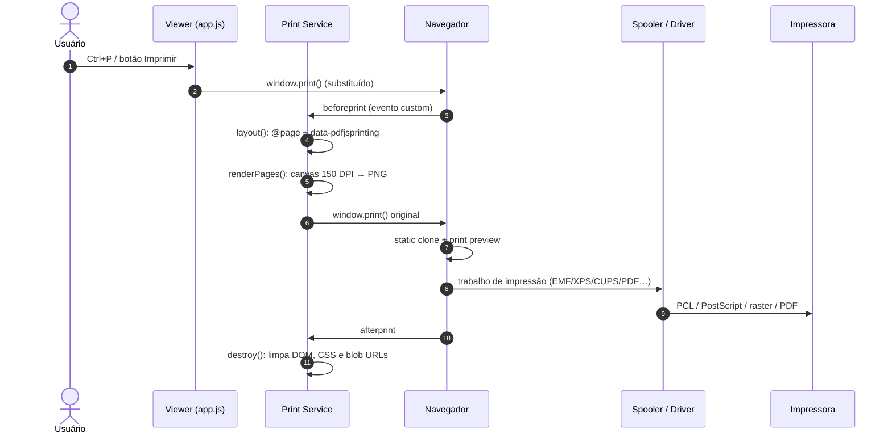

# Como o PDF.js imprime — e como ele “descobre” as impressoras

> **Alvo analisado:** [`mozilla/pdf.js`](https://github.com/mozilla/pdf.js)
> **Commit:** `50d130738a150d43669c9554909020661ded5997` (06/11/2026)
> **Versões no repositório:** stable `6.5.438`, linha de desenvolvimento `7.0.x`
> **Escopo:** viewer web (build “generic”), viewer embutido no Firefox (build `MOZCENTRAL`) e a fronteira com o sistema de impressão do navegador/SO.

---

## 1. Resposta curta

1. **O PDF.js não manda o arquivo PDF para a impressora.** Ele rasteriza cada página em um `<canvas>` a **150 DPI por padrão** e entrega esse conteúdo ao navegador.
2. **Quem fala com a impressora é o navegador.** O PDF.js chama `window.print()`; o navegador abre a pré-visualização, monta o trabalho de impressão e o entrega ao spooler/driver do sistema operacional.
3. **O PDF.js não enumera impressoras nem lê as capacidades delas.** A API de scripting do PDF.js, que imita o JavaScript do Acrobat, retorna literalmente `[]` em `app.printerNames` e `app.printColorProfiles`.
4. **Quem enumera é o navegador/SO.** No Firefox, isso acontece no código privilegiado da UI de impressão (`toolkit/components/printing`) via `nsIPrinterList`, `nsIPrinterInfo`, `nsIPaper` e `nsIPrintSettingsService`. No Chrome/Edge, acontece na WebUI interna de impressão; uma página web comum não tem acesso a esses dados.
5. **`printToPDF` no PDF.js não é impressão em papel.** É um serviço usado pelo Firefox para gerar aparências de anotações ao salvar o documento (e para o “Salvar em PDF”), não para mandar o PDF a uma impressora física.

---

## 2. Mapa do código

| Arquivo | Papel |
|---|---|
| `web/app.js` | Orquestra a impressão: `beforePrint()`, `afterPrint()`, `triggerPrinting()`, criação do serviço de impressão. |
| `web/pdf_print_service.js` | Implementação genérica (Chrome, Edge, Safari, viewer standalone, extensão Chromium). Rasteriza páginas em PNG e chama `window.print()`. |
| `web/firefox_print_service.js` | Implementação usada no Firefox (`MOZCENTRAL`). Usa `canvas.mozPrintCallback` e deixa o motor de impressão do Firefox puxar as páginas. |
| `web/print_utils.js` | Fábrica base e renderização de XFA como HTML para impressão. |
| `web/pdf_viewer.js` | `getPagesOverview()`: tamanho/rotação de cada página, com auto-rotação opcional. |
| `web/viewer.css` | Regras `@media print`, `@page`, `#printContainer`, `.printedPage`. |
| `src/display/display_utils.js` | `PixelsPerInch`: 96 CSS px/in, 72 PDF pt/in, fator `96/72`. |
| `web/app_options.js` | `printResolution` (padrão 150), `enablePrintAutoRotate` (padrão `true`). |
| `src/scripting_api/app.js` | `app.printerNames → []`, `app.printColorProfiles → []` (stubs). |
| `src/scripting_api/doc.js` | `Doc.print()` / `getPrintParams()`: compatibilidade com o JS do Acrobat, sem descoberta de impressoras. |
| `src/scripting_api/print_params.js` | Objeto `PrintParams` com campos como `printerName`, `bitmapDPI`, `pageHandling`, `duplexMode` etc. Apenas um objeto de parâmetros; não consulta o SO. |
| `web/firefoxcom.js` | Serviço externo `printToPDF` (salvar/aparências), não impressão física. |
| `gulpfile.mjs` | Escolhe em tempo de build: `web/pdf_print_service.js` para generic/Chrome; `web/firefox_print_service.js` para `MOZCENTRAL`. |

---

## 3. Fluxo genérico (Chrome, Edge, Safari, viewer standalone)

### 3.1 Gatilho

O usuário clica no botão de impressão, usa `Ctrl/Cmd+P`, ou o PDF dispara uma ação de impressão (ex.: `/OpenAction` com `Print`, ou JavaScript `WillPrint`/`DidPrint`).

Em `web/app.js`:

- `triggerPrinting()` apenas chama `window.print()` depois de verificar `supportsPrinting` e a permissão de impressão (`web/app.js:2372`).
- O módulo `pdf_print_service.js` **substitui `window.print`** no carregamento (`web/pdf_print_service.js:254`).

### 3.2 O `window.print` do PDF.js

O `window.print` substituto faz o seguinte:

1. Se já existe um trabalho ativo (`activeService`), ignora a chamada concorrente.
2. Abre o overlay de progresso (`printServiceDialog`).
3. Dispara um evento `beforeprint` próprio.
4. O `beforePrint()` do app cria o serviço de impressão e chama `layout()`.
5. Renderiza as páginas uma a uma.
6. Só então chama o `window.print` **original**, dentro de um `setTimeout`, para evitar problemas de “print em microtask”.

Trecho conceitual (o código real está em `web/pdf_print_service.js:254-287`):

```js
const print = window.print;

window.print = function () {
  if (activeService) return;

  ensureOverlay().then(() => overlayManager.open(dialog));

  dispatchEvent("beforeprint");

  activeService
    .renderPages()
    .then(() => activeService.performPrint())
    .catch(() => {})
    .then(() => {
      if (activeService.active) abort();
    });
};
```

### 3.3 `beforePrint()` e `layout()`

`PDFViewerApplication.beforePrint()` (`web/app.js:2289`) faz:

```js
this._printAnnotationStoragePromise = this.pdfScriptingManager
  .dispatchWillPrint()
  .catch(() => {})
  .then(() => this.pdfDocument?.annotationStorage.print);

this.printService = PDFPrintServiceFactory.createPrintService({
  pdfDocument: this.pdfDocument,
  pagesOverview: this.pdfViewer.getPagesOverview(),
  printContainer: this.appConfig.printContainer,
  printResolution: AppOptions.get("printResolution"), // 150
  printAnnotationStoragePromise: this._printAnnotationStoragePromise,
});

this.printService.layout();
```

`layout()` (`web/pdf_print_service.js:102`):

- Marca `<body data-pdfjsprinting>`.
- Injeta uma folha de estilo dinâmica: `@page { size: <largura>pt <altura>pt; }` usando o tamanho da **primeira** página.
- Avisa no console se as páginas têm tamanhos diferentes, porque `@page size` só expressa um tamanho.
- Verifica se o documento é XFA puro; nesse caso, em vez de rasterizar, monta o HTML do XFA (`getXfaHtmlForPrinting`) — o texto continua vetorial.

### 3.4 Renderização: canvas → PNG

`renderPage()` (`web/pdf_print_service.js:34`):

```js
const PRINT_UNITS = printResolution / PixelsPerInch.PDF; // 150 / 72

scratchCanvas.width  = Math.floor(size.width  * PRINT_UNITS);
scratchCanvas.height = Math.floor(size.height * PRINT_UNITS);

pdfPage.render({
  canvas: scratchCanvas,
  transform: [PRINT_UNITS, 0, 0, PRINT_UNITS, 0, 0],
  viewport: pdfPage.getViewport({ scale: 1, rotation: size.rotation }),
  intent: "print",
  annotationMode: AnnotationMode.ENABLE_STORAGE,
  optionalContentConfigPromise,
  printAnnotationStorage,
});
```

O que isso significa:

- **`intent: "print"`**: usa a configuração de camadas opcionais (OCG) definida para impressão, não a de tela.
- **`AnnotationMode.ENABLE_STORAGE` + `printAnnotationStorage`**: achata/desenha as anotações no bitmap; campos preenchidos e comentários entram na impressão.
- **150 DPI**: `printResolution` é 150 em `web/app_options.js:652`. Não é o DPI da impressora; é a resolução de amostragem do canvas.
- **Uma página por vez**: o mesmo `scratchCanvas` é reutilizado; o resultado vira um blob PNG e é anexado ao DOM.

`useRenderedPage()` (`web/pdf_print_service.js:196`):

```js
const img = document.createElement("img");
this.scratchCanvas.toBlob(blob => {
  const blobURL = URL.createObjectURL(blob);
  img.src = blobURL;
  (this._blobURLs ??= []).push(blobURL);
});

const wrapper = document.createElement("div");
wrapper.className = "printedPage";
wrapper.append(img);
this.printContainer.append(wrapper);
```

`canvas.toBlob()` sem tipo explícito gera **PNG**. O blob URL é revogado só no `destroy()` (depois da impressão), por causa de um bug do Firefox com service workers re-buscando a URL durante o diálogo de impressão.

### 3.5 O CSS de impressão

`web/viewer.css:1465-1522`:

```css
@page { margin: 0; }

#printContainer { display: none; }

@media print {
  body[data-pdfjsprinting] #outerContainer { display: none; }
  body[data-pdfjsprinting] #printContainer  { display: block; }

  #printContainer > .printedPage {
    page-break-after: always;
    page-break-inside: avoid;
    height: 100%;
    width: 100%;
    display: flex;
    justify-content: center;
    align-items: center;
  }

  #printContainer > .printedPage :is(canvas, img) {
    max-width: 100%;
    max-height: 100%;
  }
}
```

Ou seja: a interface do viewer some, e só o `#printContainer` (com uma `` por página) vai para a impressão. Cada `.printedPage` força quebra de página.

### 3.6 O `window.print` original

`performPrint()` (`web/pdf_print_service.js:224`):

```js
return new Promise(resolve => {
  setTimeout(() => {
    if (!this.active) return resolve();
    print.call(window);          // window.print nativo
    setTimeout(resolve, 20);
  }, 0);
});
```

A partir daqui o PDF.js sai do caminho. O navegador:

1. Congela o DOM em um “static clone” para impressão.
2. Abre a pré-visualização de impressão.
3. Compõe as páginas (as `` PNG de 150 DPI) na resolução do dispositivo de saída.
4. Envia o trabalho ao sistema de impressão do SO.

### 3.7 Diagrama



---

## 4. Caminho Firefox: `mozPrintCallback`

O Firefox é o único navegador que tem um caminho dedicado, porque o `mozPrintCallback` foi criado justamente para o PDF.js.

No build `MOZCENTRAL`, o alias `web-print_service` aponta para `web/firefox_print_service.js` (`gulpfile.mjs:268`).

### 4.1 Como funciona

Em vez de renderizar todas as páginas antes de abrir o diálogo, o PDF.js cria um `<canvas>` por página e pendura um callback:

```js
canvas.mozPrintCallback = function (obj) {
  const ctx = obj.context;

  // ... renderiza a página no contexto fornecido pelo motor de impressão ...
  pdfPage.render({ canvasContext: ctx, /* ... */ });

  // avisa o motor que esta página terminou
  obj.done();
};
```

(`web/firefox_print_service.js:59-98`)

O motor de impressão do Firefox chama esse callback **na hora de imprimir**, página por página. Isso tem duas consequências importantes:

1. **Não é preciso renderizar tudo antes**; o diálogo abre mais rápido e a memória é usada sob demanda.
2. **O callback pode ser chamado várias vezes** quando o usuário muda configurações no diálogo (tamanho do papel, orientação, escala). O próprio código comenta isso em `web/firefox_print_service.js:51-57` e cancela a renderização anterior antes de começar a próxima.

Por isso a pré-visualização do Firefox consegue se atualizar sem o PDF.js precisar “saber” qual impressora ou papel foi escolhido: o motor de impressão manda o contexto e o PDF.js apenas redesenha a página.

### 4.2 O que o Firefox ainda rasteriza

O canvas tem tamanho fixo calculado com `printResolution` (150 DPI) e a página é desenhada nele. O Firefox **não** recebe o PDF vetorial; ele recebe o bitmap do canvas (ou, no caso de XFA puro, o HTML). O motor de impressão pode escalar esse bitmap para o papel escolhido.

### 4.3 XFA

Tanto no caminho genérico quanto no Firefox, documentos XFA puros não são rasterizados: `getXfaHtmlForPrinting()` (`web/print_utils.js:38`) monta HTML/CSS a partir da XFA e o navegador imprime esse HTML. Ainda assim, não há PDF indo para a impressora.

---

## 5. O que realmente chega à impressora

O PDF.js **não** manda o arquivo PDF. O que chega ao sistema de impressão é o resultado da impressão do DOM:

- uma página por `.printedPage`;
- cada página é uma imagem PNG (no caminho genérico) ou um canvas desenhado no momento da impressão (no Firefox);
- a resolução da fonte é `printResolution` (150 DPI por padrão);
- as anotações já foram achatadas no bitmap;
- as camadas opcionais seguem a configuração de “print”;
- o tamanho de papel é sugerido por `@page { size: … }`, mas quem decide o papel final é o diálogo do navegador.

Depois disso, o formato do trabalho depende do SO e do driver:

| Plataforma | Caminho típico |
|---|---|
| Windows | Navegador → GDI/XPS → spooler (`winspool`) → driver → PCL/PostScript/raster → impressora. |
| macOS / Linux | Navegador → CUPS/IPP → filtros/driver → PCL/PostScript/raster/PDF → impressora. |
| Impressora IPP Everywhere / AirPrint | O sistema pode gerar e enviar PDF diretamente, mas é o **sistema** que gera, não o PDF.js. |

### 5.1 Limitações práticas

- **150 DPI é pouco para texto pequeno.** Para uma A4, 150 DPI dá aproximadamente **1240 × 1754 px**. Em 300 DPI, **2480 × 3508 px**. O `printResolution` pode ser aumentado programaticamente, mas o custo de memória/tempo cresce ao quadrado.
- **Tamanhos de página mistos não são suportados corretamente.** O `@page size` usa a primeira página; o PDF.js avisa no console. O Firefox redimensiona as demais para o tamanho inicial.
- **A pré-visualização pode reamostrar a imagem.** O navegador encaixa a imagem no papel escolhido; uma página Letter impressa em A4 é escalada pelo navegador, não pelo PDF.js.
- **Não há “passthrough” de PDF.** Se você precisa que o PDF original chegue ao driver (para preservar texto vetorial, fontes, overprint etc.), o caminho do PDF.js não serve; é preciso usar o visualizador nativo do navegador ou um app nativo que envie o PDF ao spooler.

### 5.2 Exemplo de dimensões

| Papel | Tamanho em pt | 150 DPI | 300 DPI |
|---|---:|---:|---:|
| A4 | 595 × 842 | 1240 × 1754 | 2480 × 3508 |
| Letter | 612 × 792 | 1275 × 1650 | 2550 × 3300 |
| A3 | 842 × 1191 | 1754 × 2481 | 3508 × 4961 |

---

## 6. A parte que o PDF.js **não** faz: configurações da impressora

Esta é a conclusão mais importante da investigação: **o PDF.js não consulta impressoras, não lista papéis, não lê duplex, cor, bandejas ou margens.**

### 6.1 Provas dentro do repositório

#### `app.printerNames` é um stub

`src/scripting_api/app.js:341-347`:

```js
get printerNames() {
  return [];
}

set printerNames(_) {
  throw new Error("app.printerNames is read-only");
}
```

E `app.printColorProfiles` também retorna `[]` (`src/scripting_api/app.js:333-339`).

Isso é a implementação da API de scripting que imita o Acrobat JavaScript. Ela existe para que PDFs com JavaScript não quebrem, não para descobrir impressoras.

#### `Doc.print()` ignora quase todos os parâmetros

`src/scripting_api/doc.js:1210-1249` aceita a assinatura do Acrobat:

```js
print(bUI, nStart, nEnd, bSilent, bShrinkToFit, bPrintAsImage,
      bReverse, bAnnotations, printParams)
```

Mas o próprio código comenta:

```js
// TODO: for now just use nStart and nEnd
// so need to see how to deal with the other params
// (if possible)
if (printParams) {
  nStart = printParams.firstPage;
  nEnd = printParams.lastPage;
}
```

Ou seja: `printerName`, `bitmapDPI`, `duplexMode`, `pageHandling` etc. existem no objeto `PrintParams`, mas **não são usados para consultar nem para configurar a impressora**. No máximo, página inicial/final viram um comando de impressão para o viewer.

#### `printToPDF` não é impressão física

`web/firefoxcom.js:715` expõe um serviço externo chamado `printToPDF`, mas ele é usado em `web/app.js:1515-1519` dentro de `save()`:

```js
const data = await pdfDocument.saveDocument({
  printToPDF: this.externalServices.printToPDF,
});
```

No worker, `PrintToPDF` serve para gerar aparências de anotações ao salvar (`src/core/worker.js`, mensagem `"PrintToPDF"`). É uma implementação do “Salvar em PDF” do Firefox, não um caminho para a impressora.

### 6.2 Quem realmente enumera: o Firefox

O código que faz isso **não está no repositório do PDF.js**. Está no código privilegiado do Firefox, em `toolkit/components/printing/content/print.js` e `printUtils.js`. O PDF.js é apenas o conteúdo impresso.

#### Lista de impressoras

```js
const printerList = Cc["@mozilla.org/gfx/printerlist;1"]
  .createInstance(Ci.nsIPrinterList);

const printers = await printerList.printers;
const fallbackPaperList = await printerList.fallbackPaperList;
const defaultPrinterName = printerList.systemDefaultPrinterName;
const lastUsedPrinterName = PSSVC.lastUsedPrinterName;
```

(`getPrintDestinations()` em `print.js`)

#### Capacidades de cada impressora

```js
const [supportsDuplex, supportsColor, supportsMonochrome, printerInfo] =
  await Promise.all([
    printer.supportsDuplex,
    printer.supportsColor,
    printer.supportsMonochrome,
    printer.printerInfo,
  ]);

printerInfo.QueryInterface(Ci.nsIPrinterInfo);
printerInfo.defaultSettings.QueryInterface(Ci.nsIPrintSettings);

const paperList = printerInfo.paperList;       // nsIPaper[]
const defaults  = printerInfo.defaultSettings; // nsIPrintSettings
```

(`resolvePropertiesForPrinter()` em `print.js`)

Cada `nsIPaper` traz:

- `id`, `name`;
- `width`, `height` (em pontos);
- `unwriteableMargin` (assíncrono), com as margens que a impressora fisicamente não consegue imprimir.

Cada `nsIPrintSettings` traz, entre outros:

- `printerName`, `paperId`, `paperWidth`, `paperHeight`, `paperSizeUnit`;
- `orientation`, `scaling`, `shrinkToFit`;
- `marginTop/Right/Bottom/Left`;
- `printInColor`, `printBGColors`, `printBGImages`;
- `duplex`, `numCopies`;
- `headerStrLeft/Center/Right`, `footerStrLeft/Center/Right`;
- `outputDestination`, `toFileName`, `outputFormat`.

#### Defaults e preferências por impressora

```js
const PSSVC = Cc["@mozilla.org/gfx/printsettings-service;1"]
  .getService(Ci.nsIPrintSettingsService);

const settings = PSSVC.createNewPrintSettings();
settings.printerName = printerName;

PSSVC.initPrintSettingsFromPrinter(printerName, settings);
PSSVC.initPrintSettingsFromPrefs(settings, true, settings.kInitSaveAll);
```

(`PrintUtils.getPrintSettings()` em `printUtils.js`)

Isso explica por que o diálogo “lembra” papel, orientação, margens etc. por impressora: o Firefox persiste esses valores em prefs no formato `print.printer_<nome>.*` e os reaplica com `initPrintSettingsFromPrefs`.

#### O PDF é tratado como caso especial

Em `print.js`:

```js
const sourceIsPdf =
  !sourcePrincipal.isNullPrincipal &&
  sourcePrincipal.spec == PDF_JS_URI;

if (sourceIsPdf) {
  this.printForm.removeNonPdfSettings();
}
```

Ou seja, quando o conteúdo é o viewer do PDF.js, o Firefox remove opções que não fazem sentido para PDF (por exemplo, cabeçalho/rodapé e algumas opções de página). Isso é mais uma evidência de que quem manda no diálogo é o navegador, não o PDF.js.

#### Onde os settings viram impressão

No fim, `print.js` chama:

```js
await this._doPrint(browsingContext, settings);

_doPrint(browsingContext, settings) {
  return browsingContext.print(settings);
}
```

O `settings` é um `nsIPrintSettings` preenchido com dados da impressora e do usuário. O motor de impressão do Firefox usa esse objeto para gerar o trabalho e entregar ao backend de plataforma.

#### Backend de plataforma (resumo)

- **Windows:** `nsIPrinterList`/`nsIPrinterInfo` acabam usando a API de spooler (`EnumPrinters`, `OpenPrinter`, `GetPrinter`, `DeviceCapabilities`/`DocumentProperties` com `DEVMODE`) para listar impressoras e capacidades.
- **macOS/Linux:** CUPS/IPP (`cupsGetDests`, atributos IPP como `media-*`, `sides`, `print-color-mode`, PPDs).
- O PDF.js não participa de nenhuma dessas chamadas.

### 6.3 Quem realmente enumera: Chrome/Edge

No Chromium, `window.print()` entra no fluxo de impressão do próprio navegador:

1. O conteúdo é congelado em um “static clone”.
2. O Chromium abre a **WebUI interna de impressão** (a página `chrome://print`, implementada no browser process).
3. A WebUI consulta o backend de impressão do Chromium (`PrintBackend`), que no Windows usa o spooler e no Linux/macOS usa CUPS.
4. As capacidades viram as opções do diálogo: impressora, papel, layout, cor, margens, escala, duplex, cópias, páginas, cabeçalho/rodapé etc.
5. Ao confirmar, o trabalho é enviado ao spooler.

**Uma página web comum não tem API para listar impressoras ou ler essas capacidades.** O PDF.js, rodando como página web, não tem como acessar a WebUI nem o `PrintBackend`.

Exceções que não se aplicam ao PDF.js:

- **`chrome.printing`**: API de extensão, **somente ChromeOS**, com `getPrinters()`, `getPrinterInfo()` (capacidades em CDD) e `submitJob()` (PDF/PNG). Não é usada pelo PDF.js e não existe em páginas web normais no Windows/macOS/Linux.
- **`chrome.printing` em kiosk/managed devices**: permite impressão silenciosa, mas continua sendo um recurso de extensão/política corporativa.
- **Electron**: `webContents.getPrintersAsync()` e `webContents.print(options)` expõem uma lista de impressoras e algumas opções (deviceName, pageSize, margins, landscape, copies, dpi, duplex etc.), mas isso é API do Electron, não do PDF.js.
- **Proposta WICG “Web Printing API”**: não é padrão estável nem é usada pelo PDF.js.

### 6.4 Tabela comparativa

| Informação | PDF.js (viewer web) | Firefox (UI de impressão) | Chrome/Edge (UI de impressão) |
|---|---|---|---|
| Lista de impressoras | Não | Sim (`nsIPrinterList.printers`) | Sim (WebUI + `PrintBackend`) |
| Impressora padrão | Não | Sim (`systemDefaultPrinterName`) | Sim |
| Papéis disponíveis | Não | Sim (`nsIPrinterInfo.paperList` / `nsIPaper`) | Sim |
| Margens não imprimíveis | Não | Sim (`nsIPaper.unwriteableMargin`) | Sim |
| Duplex | Não | Sim (`printer.supportsDuplex`) | Sim |
| Cor / monocromático | Não | Sim (`supportsColor`, `supportsMonochrome`) | Sim |
| Padrões salvos por impressora | Não | Sim (prefs `print.printer_<nome>.*`) | Sim |
| Tamanho de página do PDF | Sim, como dica (`@page size`) | Sim, e pode adotar como papel | Sim, como dica |
| Resolução de rasterização | Sim (`printResolution`, 150) | Sim (150 no canvas) | Sim (150 na imagem) |
| Enviar PDF original ao driver | Não | Não pelo PDF.js | Não pelo PDF.js |

---

## 7. Como o PDF.js influencia as configurações (mesmo sem conhecê-las)

O PDF.js não lê as configurações, mas influencia algumas escolhas:

1. **Tamanho de papel via `@page`**
   `layout()` injeta `@page { size: Wpt Hpt; }`. O Firefox tem uma lógica de `usePageRuleSizeAsPaperSize` que pode usar esse tamanho como tamanho de papel e esconder o seletor de papel no diálogo. É uma cooperação indireta: o PDF.js informa o tamanho; o Firefox decide.

2. **Orientação/rotação**
   `getPagesOverview()` (`web/pdf_viewer.js:2228`) devolve `width`, `height` e `rotation`. Com `enablePrintAutoRotate` (padrão `true`), páginas com orientação diferente da primeira são rotacionadas 90° para caber na orientação inicial.

3. **Camadas opcionais**
   `intent: "print"` faz o PDF.js usar a configuração de OCG de impressão. O usuário pode ter uma camada visível na tela e oculta na impressão.

4. **Anotações**
   `AnnotationMode.ENABLE_STORAGE` + `printAnnotationStorage` achatam anotações e valores de formulário no bitmap. O que o usuário vê preenchido é o que sai.

5. **DPI**
   `printResolution` controla a qualidade da fonte rasterizada. É a única “configuração de impressão” realmente sob controle do PDF.js.

6. **Páginas**
   O intervalo inicial/final pode vir de `Doc.print()` (JavaScript do PDF), mas quem recorta o intervalo no trabalho final ainda é o diálogo do navegador.

---

## 8. Se você precisa imprimir PDF de verdade (passthrough)

O caminho do PDF.js é adequado para “imprimir o que está na tela”, mas não para preservar o PDF original. Se o requisito é mandar o PDF ao driver/spooler:

### 8.1 App nativo

- **Windows:** `EnumPrinters` + `OpenPrinter` + `GetPrinter`/`DeviceCapabilities`/`DocumentProperties` para capacidades; `StartDoc`/`StartPage`/`EndPage`/`EndDoc` (GDI) ou XPS para o trabalho.
- **macOS/Linux:** CUPS (`cupsGetDests`, `cupsPrintFile`, opções IPP) ou `lp`/`lpr`.
- **PDF direto:** impressoras IPP Everywhere/AirPrint aceitam PDF; caso contrário, o driver converte.

### 8.2 Electron

```js
const printers = await win.webContents.getPrintersAsync();
// printers: name, displayName, description, status, isDefault, options...

win.webContents.print({
  silent: false,
  deviceName: printers[0].name,
  pageSize: "A4",
  landscape: false,
  copies: 1,
  // margins, dpi, duplex etc. dependem da versão do Electron
});
```

Atenção: `webContents.print()` imprime o conteúdo carregado; para imprimir um PDF, carregue-o em uma janela/`BrowserWindow` (ou use um visualizador nativo) e imprima. O Electron repassa as opções ao backend do Chromium; nem toda capacidade da impressora é exposta.

### 8.3 Firefox privilegiado / extensão

Não existe API pública para uma página web listar impressoras. Uma extensão privilegiada ou código chrome pode usar `nsIPrinterList`/`nsIPrintSettingsService`, mas isso exige privilégios de plataforma e não é o que o PDF.js faz.

### 8.4 ChromeOS gerenciado

`chrome.printing` (extensão, ChromeOS) permite `getPrinters()`/`getPrinterInfo()` e `submitJob()` com PDF/PNG. É a exceção mais próxima de “mandar o PDF direto”, mas é específica de ChromeOS e de extensões.

---

## 9. Pegadinhas e detalhes que costumam confundir

- **“O PDF.js manda o PDF para a impressora”**: falso. Ele manda páginas rasterizadas para o navegador; o PDF original não sai do processo do viewer.
- **“O PDF.js leu as configurações da impressora”**: falso. `app.printerNames` retorna `[]`; o diálogo é do navegador.
- **“`printToPDF` é a impressão”**: não. É o serviço de “Salvar em PDF”/aparências de anotações no Firefox.
- **“`PrintParams.printerName` escolhe a impressora”**: o campo existe por compatibilidade com o Acrobat JS, mas `Doc.print()` só usa `firstPage`/`lastPage`.
- **“`@page size` garante o papel”**: é uma dica. O usuário pode escolher outro papel no diálogo; o navegador escala a imagem.
- **“150 DPI é a resolução da impressora”**: não. É a resolução do canvas; a impressora pode ter 600/1200 DPI, mas receberá uma imagem de 150 DPI reamostrada.
- **“O Firefox imprime vetorial porque usa `mozPrintCallback`”**: não. O callback desenha em um canvas; o conteúdo entregue ao motor é bitmap (exceto XFA, que é HTML).
- **“O Chrome tem `chrome.printing`”**: só no ChromeOS e para extensões; não é uma API web geral.
- **“`window.print()` é síncrono”**: não é. O PDF.js usa `setTimeout` e espera o `afterprint` para limpar o DOM.

---

## 10. Referências

### Código do PDF.js (commit `50d1307`)

| Tema | Arquivo:linha |
|---|---|
| `renderPage` (canvas 150 DPI) | `web/pdf_print_service.js:34-78` |
| `PDFPrintService` | `web/pdf_print_service.js:80-241` |
| `layout()` / `@page` | `web/pdf_print_service.js:102-130` |
| `renderPages()` | `web/pdf_print_service.js:163-194` |
| `useRenderedPage()` (PNG/blob) | `web/pdf_print_service.js:196-212` |
| `performPrint()` | `web/pdf_print_service.js:224-241` |
| Substituição de `window.print` | `web/pdf_print_service.js:254-287` |
| `composePage` / `mozPrintCallback` | `web/firefox_print_service.js:29-126` |
| `FirefoxPrintService.layout()` | `web/firefox_print_service.js:147-197` |
| `beforePrint()` / `afterPrint()` | `web/app.js:2289-2360` |
| `triggerPrinting()` | `web/app.js:2372-2376` |
| `getPagesOverview()` | `web/pdf_viewer.js:2228-2252` |
| CSS de impressão | `web/viewer.css:1465-1522` |
| `PixelsPerInch` | `src/display/display_utils.js:19-25` |
| `printResolution` / auto-rotação | `web/app_options.js:446-451`, `:652-657` |
| `app.printerNames` / `printColorProfiles` | `src/scripting_api/app.js:333-347` |
| `Doc.print()` / `getPrintParams()` | `src/scripting_api/doc.js:1138-1140`, `:1210-1249` |
| `PrintParams` | `src/scripting_api/print_params.js:16-179` |
| `printToPDF` (salvar) | `web/firefoxcom.js:715-722`; `web/app.js:1515-1519` |
| Escolha do serviço por build | `gulpfile.mjs:239`, `:253`, `:268` |

### Firefox (mozilla-central)

- `toolkit/components/printing/content/print.js`
  - `getPrintDestinations()`: `nsIPrinterList`, `printers`, `fallbackPaperList`, `systemDefaultPrinterName`.
  - `resolvePropertiesForPrinter()`: `nsIPrinter.supportsDuplex/supportsColor/supportsMonochrome/printerInfo`, `nsIPrinterInfo.paperList/defaultSettings`, `nsIPaper`.
  - `sourceIsPdf` + `removeNonPdfSettings()`.
  - `_doPrint()` → `browsingContext.print(settings)`.
- `toolkit/components/printing/content/printUtils.js`
  - `PrintUtils.getPrintSettings()`: `nsIPrintSettingsService`, `initPrintSettingsFromPrinter`, `initPrintSettingsFromPrefs`.
  - `handleSystemPrintDialog()`: diálogo nativo + persistência de prefs.
- `toolkit/components/pdfjs/content/PdfjsParent.sys.mjs`
  - Não trata impressão; a impressão do viewer é o fluxo genérico de conteúdo do Firefox.

### Documentação e histórico

- MDN — `HTMLCanvasElement.mozPrintCallback` (API não padrão, específica do Firefox).
- Mozilla Labs — “A New Way to Control Printing Output” (2012), origem do `mozPrintCallback` para o PDF.js: <https://blog.mozilla.org/labs/2012/09/a-new-way-to-control-printing-output/>
- Chrome for Developers — `chrome.printing` (somente ChromeOS): <https://developer.chrome.com/docs/extensions/reference/api/printing>
- Electron — `webContents.getPrintersAsync()` / `webContents.print()`.

---

## 11. Conclusão

O PDF.js resolve o problema de impressão de um jeito deliberadamente simples e portátil:

- **não** tenta falar com impressoras;
- **não** tenta descobrir capacidades;
- **não** envia o PDF;
- renderiza páginas em 150 DPI (ou no valor configurado) e deixa o navegador fazer o resto.

A “mágica” de ver a impressora, o papel, o duplex e as margens no diálogo não é do PDF.js: é da UI de impressão do navegador, que no Firefox usa `nsIPrinterList`/`nsIPrinterInfo`/`nsIPaper`/`nsIPrintSettingsService` e, no Chromium, a WebUI de impressão + `PrintBackend` do sistema. Se um app precisa dessas informações, ele precisa de uma camada nativa (ou de uma API privilegiada como `chrome.printing` no ChromeOS) — não do PDF.js.

---

## 12. O que o PlotS adota

O PlotS e um app nativo e precisa falar direto com o spooler, sem o dialogo do navegador. A
pesquisa acima muda duas decisoes do projeto:

1. **Desenho:** o equivalente nativo ao canvas do PDF.js e rasterizar a pagina e entrega-la ao
   driver por um DC de memoria com bitmap compativel e `StretchBlt` (`HALFTONE`), nao por um
   `StretchDIBits` de 32 bpp direto no DC da impressora. O PDF.js tambem nao entrega um DIB de
   600 dpi ao driver; o navegador compoe a pagina. O `StretchDIBits` continua so como reserva.
2. **Configuracoes da impressora:** o PDF.js nao as conhece; quem as expoe e uma camada
   nativa. O PlotS usa `OpenPrinter` + `DeviceCapabilities`/`DocumentProperties` + `DEVMODE`
   para a chave de boca ao lado da engrenagem. O painel mostra so o que o driver responde e
   aplica no ajuste salvo da fila. Papel, uma face, copias, escala, orientacao e uma pagina por
   folha continuam sendo decisao do PlotS e nao aparecem como opcao.
3. **Resolucao:** o PDF.js usa 150 dpi de amostragem por padrao; o PlotS mantem a resolucao do
   driver e o painel permite escolher uma menor quando o driver nao aguentar a padrao.

A opcao "Frente" do PlotS passa a mandar as paginas impares (a frente real da folha), e
"Verso" as pares; antes "Frente" mandava a primeira passada, que em documento de 1 pagina e a
face em branco. E a correcao do mesmo relato de folha em branco.
---

## 13. Licenças dos trechos citados

Os trechos de código reproduzidos neste documento servem só para análise de interoperabilidade:
PDF.js — © Mozilla Foundation, Apache-2.0; Firefox/mozilla-central — © Mozilla Contributors,
MPL-2.0. Os excertos permanecem sob as licenças originais e não fazem parte do código nem da
licença MIT do PlotS.

---

## 13. Licencas dos trechos citados

Os trechos de codigo reproduzidos neste documento servem so para analise de interoperabilidade:
PDF.js - (c) Mozilla Foundation, Apache-2.0; Firefox/mozilla-central - (c) Mozilla Contributors,
MPL-2.0. Os excertos permanecem sob as licencas originais e nao fazem parte do codigo nem da
licenca MIT do PlotS.
